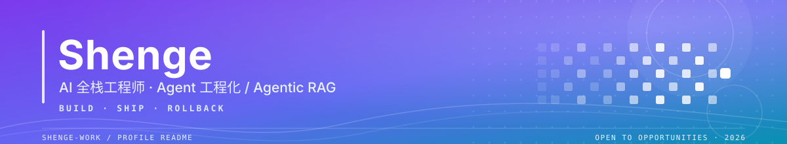

  

**Shenge（陈培胜）· AI 全栈工程师 / Agent 方向**

> 这一页是**索引**，不是简历全文。履历、项目详情、技能矩阵与获奖证书以 [在线作品集](https://shenge-work.github.io) 为准。

## ⚡ 速览 · At a Glance

| | |
| :--- | :--- |
| **定位** | AI 全栈工程师 · Agent 工程化 / Agentic RAG |
| **经验** | 5 年工程实战，主导 6 套系统从 0 到 1 |
| **专长** | Agent 编排 · MCP / Skill 生态 · 多租户云沙箱 · 实时数据链路 |
| **原则** | 不停机 · 可回滚 · 最小改动 |
| **背景** | 软件工程本科 · 国家励志奖学金 · 在职获评「高级程序员」 |
| **地点** | 深圳 / 广州 / 远程 |
| **状态** | 🟢 开放新机会 · 随时到岗 |

## 🎯 现在 · Now

- 开放 **AI 全栈 / Agent 平台** 方向的机会，随时到岗，可直接邮件联系。
- 持续维护两个开源项目：[`career-agent`](https://github.com/shenge-work/career-agent)（本地优先求职工作台：PGlite + Electron + E2EE 跨设备同步）与 [`im-gateway`](https://github.com/shenge-work/im-gateway)（Go 多平台 IM 统一网关：分布式租约与幂等）。
- 完整档案 → [shenge-work.github.io](https://shenge-work.github.io)

## 🔓 精选开源 · Open Source

> 下面每个链接都指向真实存在的仓库，点开即有源码与 README。

| 项目 | 语言 / License | 看点 |
| :--- | :--- | :--- |
| [**career-agent**](https://github.com/shenge-work/career-agent) | TypeScript · MIT | 本地优先的求职工作台：岗位为第一公民，A4 实时简历预览与矢量 PDF、公司档案 / 内推 / 投递追踪，PGlite + Electron 桌面端，E2EE 跨设备同步与冲突恢复 |
| [**im-gateway**](https://github.com/shenge-work/im-gateway) | Go · Apache-2.0 | 多平台 IM 统一网关：适配器屏蔽飞书 / 钉钉 / 企微 / 微信 / QQ 差异，六段流水线 + 分布式租约 / 去重 / 限流，单一二进制零运行时依赖 |
| [**shenge-work.github.io**](https://github.com/shenge-work/shenge-work.github.io) | JavaScript | 在线求职作品集：履历 / 项目 / 技能 / 证书，附 AI 简历问答 |

## 🛠️ 技术栈 · Tech Stack

**Languages & Frameworks**

<picture>
  <source media="(prefers-color-scheme: dark)" srcset="https://skillicons.dev/icons?i=python,java,ts,js,go,vue&theme=dark" />
  
</picture>

**Backend & Infra**

<picture>
  <source media="(prefers-color-scheme: dark)" srcset="https://skillicons.dev/icons?i=spring,mysql,redis,docker,kubernetes,jenkins,git,linux&theme=dark" />
  
</picture>

**AI / Agent**

## 🐍 贡献图 · Contribution Snake

<picture>
  <source media="(prefers-color-scheme: dark)" srcset="https://raw.githubusercontent.com/shenge-work/shenge-work/output/github-snake-dark.svg" />
  <source media="(prefers-color-scheme: light)" srcset="https://raw.githubusercontent.com/shenge-work/shenge-work/output/github-snake.svg" />
  
</picture>

由 `.github/workflows/snake.yml` 每日 02:00 UTC 自动生成并推送到 `output` 分支，无需手动维护。

## 📫 联系 · Let's Connect

 

最后更新 2026.11 · 内容以 <a href="https://shenge-work.github.io">在线作品集</a> 为准

